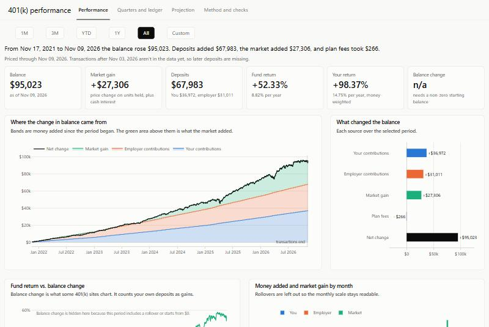

# r401k

An R package and Shiny dashboard for 401(k) transaction data. It answers the question a 401(k) website should answer first: **how much of my balance came from what I put in, and how much came from the market?**



## Why this exists

Some 401(k) dashboards show the change in your balance from one date to the next and report it as a percent. That counts every paycheck deposit as if it were investment return. A balance can be up 20% in a year the fund returned 10%, and the chart gives you no way to tell.

This package rebuilds your account from its transactions and your fund's daily price, then keeps three different things separate:

- **Fund return:** what the fund itself did. Your deposits can't affect it.
- **Your return:** a money-weighted return (XIRR) that reflects when your money actually arrived, net of plan fees.
- **Balance change:** the misleading number, shown next to the others so you can see the gap.

Any account you can describe as dated transactions in a single fund will work.

## Install

```r
install.packages("remotes")
remotes::install_github("chjacamp/r401k")
```

It needs R 4.1 or later.

## Quick start

```r
r401k::run_app()
```

That opens the dashboard on the bundled demo: five years of made-up paychecks from a $0 start, priced against the real daily NAV of the Vanguard Target Retirement 2060 Trust Select (fund 1685).

`run_app()` returns a Shiny app object, which runs when printed at the console. From a script or a terminal, use:

```r
shiny::runApp(r401k::run_app(), launch.browser = TRUE)
```

## What's in the dashboard

- **Performance:** for any period, how much came from you, your employer, a rollover, the market, and fees. Also monthly bars, risk stats, and implied pay and contribution rates.
- **Quarters and ledger:** a quarter-by-quarter table, balances by money source, and every transaction.
- **Projection:** retirement balance from your pay, raises, contribution rate, and yearly rate increases, compared across contribution rates.
- **Method and checks:** what each number means, and optionally how the rebuilt history compares with balances from your statements.

## Use your own data

Keep your data in a folder of your own. Don't edit the demo files inside the installed package, because reinstalling the package replaces them.

The easiest start is a copy of the demo:

```r
library(r401k)

use_example_data("~/my401k")   # copies transactions.csv and nav_1685.csv
run_app("~/my401k")
```

Then replace those two files with your own, as described below, and describe your plan:

```r
run_app(
  "~/my401k",
  fund_name = "My Target Date Fund",
  plan = plan_settings(nonelective = 0.03, match_rate = 1, match_cap = 0.04, monthly_fee = 5)
)
```

To make `run_app()` and `load_401k()` open your folder without passing it each time, set the `r401k.data_dir` option, for example in your `.Rprofile`:

```r
options(r401k.data_dir = "~/my401k")
```

The folder holds two files:

**1. Daily prices** as `nav_<fund_id>.csv`. The id is any name you like.

```csv
date,nav
2024-01-02,50.12
2024-01-03,49.87
```

`nav` has to be a total-return series, meaning it doesn't drop when the fund pays a distribution. Collective trusts usually qualify as published, because they reinvest internally. For a mutual fund or ETF, use an adjusted close, and don't also list reinvested distributions as transactions.

**2. Transactions** as `transactions.csv`:

```csv
date,type,amount,source,holding
2024-01-17,contribution,300.00,Employee pre-tax,fund
2024-01-17,contribution,150.00,Employer match,fund
2024-02-16,fee,-4.50,,fund
```

| Column | Required | Meaning |
|---|---|---|
| `date` | yes | `YYYY-MM-DD`, the day the money was priced (the "effective date" on a statement) |
| `type` | yes | `contribution`, `rollover`, `fee`, `withdrawal`, `dividend`, or `transfer` |
| `amount` | yes | Dollars. Negative for withdrawals and normal fees |
| `source` | for deposits | Who funded it. Anything starting with `Employer` counts as employer money |
| `holding` | no | `fund` (default) or `cash`. Dividends default to `cash` |

A `transfer` moves money between cash and the fund; a positive amount moves it into the fund. Use `dividend` for interest on a cash position. Every balance, return, and chart is computed from these two files.

### Settings

- `plan_settings()` describes your employer's contributions and fees. The non-elective rate is also used to infer your pay from employer contributions.
- `projection_settings()` sets the projection tab's starting values, such as `retirement_year` and `expected_return`. Leaving `annual_pay` and `your_rate` as `NA` infers them from your data.

See `?run_app`, `?plan_settings`, and `?projection_settings` for every option.

### Optional: check against your statements

If you add `balances.csv` with balances copied from your statements, the checks tab compares them with the rebuilt history. That's a quick way to catch a missing or mistyped transaction. The app doesn't use this file for any calculation.

```csv
date,balance,units,unit_price,reported_return
2024-03-31,10250.14,165.102,62.08,0.0412
```

Only `date` and `balance` are required.

### Updating prices

`update_nav()` takes any function of `(start, end)` that returns `date` and `nav`, requests only the dates missing from your price file, and merges them in. For example, from a file you downloaded:

```r
from_my_download <- function(start, end) {
  x <- read.csv("~/Downloads/my_fund_prices.csv")
  data.frame(date = as.Date(x$Date, "%m/%d/%Y"), nav = x$Price)
}

update_nav("~/my401k", from_my_download, fund_id = "my_fund")
```

### Working with the numbers in R

```r
x <- load_401k("~/my401k")
x$quarters   # fund return, money-weighted return, and balance change by quarter
x$daily      # one row per trading day: units, balance, deposits, market gain
```

### Trying it with your own fund's prices

`make_demo_data()` writes the same kind of made-up history as the demo into any folder that has a price file, so you can see your fund in the dashboard before entering real transactions.

## Price data

The demo's price file is the trust's published daily NAV, included so the demo runs offline. The package has no code that downloads prices. For your own fund, supply prices yourself or through `update_nav()`, and check the terms of any source you automate, since many fund websites restrict automated access.

Your data stays in your own folder. The package only reads it.

## How the numbers work

Each deposit buys units at the price on its date, and each fee sells units the same way. Daily market gain is yesterday's units times today's price change, plus any cash interest. The fund's return comes only from its prices. Your return is the rate that makes your dated cash flows equal your ending balance.

After your last transaction, units are held flat and priced daily, so later deposits don't appear until you add them.

## License

[MIT](LICENSE.md), covering the code in this package. It doesn't cover the demo's price file, which is the fund's published price history, or any third-party names.

## Disclaimer

Not affiliated with or endorsed by Vanguard or any 401(k) plan provider. Fund names are trademarks of their owners and are used only to identify the demo's price data. This is a personal project for information only and isn't investment, tax, or legal advice. Projections are arithmetic on assumptions you choose, not forecasts. Provided as is, with no warranty.
